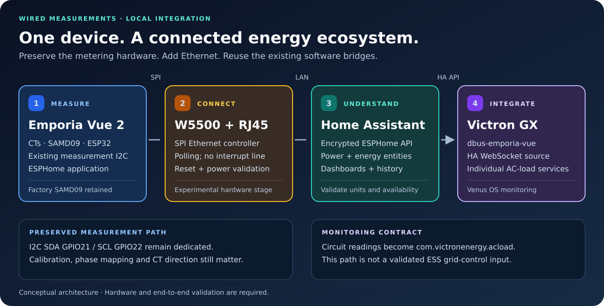
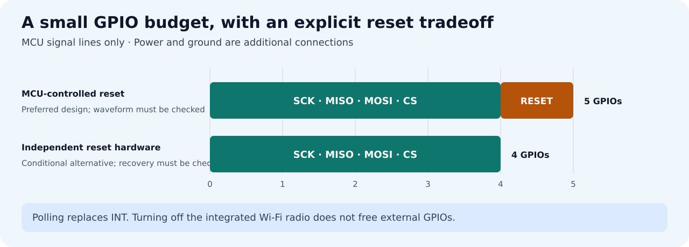

# Emporia Vue 2 · Ethernet · ESPHome

**Add a physical Ethernet connection to an Emporia Vue 2 and bring its circuit measurements into Home Assistant and the Victron ecosystem.**

[](https://github.com/victron-venus/esphome-emporia-vue2-ethernet/actions/workflows/validate.yml)
[](LICENSE)
[](docs/hardware.md)

This project documents a W5500 Ethernet retrofit, provides ESPHome configuration packages, and connects the resulting local measurements to Home Assistant and Victron Venus OS. The design preserves the existing measurement controller and uses Ethernet as the only network interface.

**Status:** the software approach has passed an ESPHome build using a synthetic configuration. The physical retrofit, supply capacity, isolation, and candidate GPIO assignments still require verification on an actual board. The configuration packages deliberately leave the hardware pins unassigned.



## Can I install it from a web page?

A reviewed device configuration can be compiled in ESPHome Device Builder and
written over USB using **[ESPHome Web](https://web.esphome.io/)**, without a local
Python/PlatformIO installation. Read the [browser flashing guide](docs/browser-install.md).
This experimental retrofit does **not** yet have a hardware-validated public
firmware image: GPIO assignment, reset timing, isolation and measurement setup
must be resolved before flashing. Compiler fixtures are not device firmware.

## The problem and solution

The Vue 2 has useful whole-installation and circuit-level measurements, but no built-in Ethernet port. A wired local installation needs both an Ethernet controller and firmware support.

Use a **W5500 module with an Ethernet transformer and RJ45 connector**, connected to the existing ESP32 over SPI. ESPHome already supports this controller. Keep the factory SAMD09 measurement firmware and its I2C connection; replace the ESP32 network/application firmware with ESPHome.

The integration path is:

```text
Vue 2 measurements → ESPHome → W5500 / Ethernet → Home Assistant
                                                   ↓
                                      dbus-emporia-vue on Venus OS
                                                   ↓
                                      Individual Victron AC loads
```

The Victron connection uses the existing [dbus-emporia-vue](https://github.com/victron-venus/dbus-emporia-vue) Home Assistant source. This repository supplies the hardware design and integration documentation, rather than another copy of that driver.

## What the project provides

| Area | Approach | Current boundary |
| --- | --- | --- |
| Physical Ethernet | W5500 over SPI, with RJ45 and magnetics | Board, power, isolation and enclosure must be verified |
| Measurement acquisition | Existing SAMD09 firmware and I2C on GPIO21/22 | Preserve calibration, CT mapping and phase assignments |
| ESPHome networking | Ethernet only; polling avoids an interrupt GPIO | Example configuration is not a flash-ready device image |
| Home Assistant | Encrypted ESPHome native API | Configure actual entities and validate units and availability |
| Energy dashboards | Correctly classified kWh sensors or power integration | Separate import/export; avoid double counting |
| Victron Venus OS | HA power entities forwarded as `com.victronenergy.acload` | Monitoring path; not a validated grid meter or ESS control input |

## Hardware design


The ESP32's Wi-Fi radio is integrated, so disabling Wi-Fi does not release external GPIOs. **GPIO23, used by the status LED, is a separate candidate for W5500 reset** after inspecting and, if necessary, disconnecting the LED circuit.

The proposed assignments are GPIO18/SCK, GPIO19/MISO, GPIO25/MOSI, GPIO33/CS and GPIO23/RESET. These are candidates for board inspection, not approved soldering instructions. GPIO21/22 remain reserved for measurement I2C. GPIO26 must not be assumed free.

Read the [hardware design](docs/hardware.md) before selecting a module or changing the board. It covers the pin map, reset behavior, supply requirements, isolation and physical mounting.

**Open reset issue:** the inspected ESP-IDF W5500 driver requests a 100 µs delay while reset is asserted, against a 500 µs minimum in the datasheet. This is a source-level timing gap, not a measurement of the actual pulse or proof that every module fails. Reset handling and startup timing need correction and verification before this design can be treated as ready for hardware use.

### Signal budget



Polling removes the need for an interrupt line. The preferred design retains an MCU-controlled reset. A four-signal alternative needs a separately verified reset circuit and recovery tests; a power-on reset alone does not necessarily recover the controller after an ESP32-only restart. Power and ground are additional connections in both cases.

## Documentation

| Guide | Contents |
| --- | --- |
| [Hardware](docs/hardware.md) | Candidate pins, W5500 selection, reset, power and isolation |
| [ESPHome firmware](firmware/README.md) | Packages, backup, initial UART flashing and validation |
| [Home Assistant and Victron](docs/integrations.md) | Local data path, entity mapping, energy and AC-load services |
| [Verification](docs/verification.md) | Board checks, startup/recovery, measurements and end-to-end acceptance |
| [Repository maintenance](docs/maintenance.md) | Checks, contribution boundaries and Terraform ownership |

## Implementation sequence

1. **Inspect the disconnected board.** Confirm the revision, candidate GPIO continuity, LED circuit, supply headroom and isolation requirements.
2. **Back up the ESP32 flash.** Save the full detected flash contents, including NVS, privately. Preserve the factory SAMD09 firmware.
3. **Prepare the ESPHome configuration.** Replace `GPIO_TBD_*` only with verified assignments. Configure measurement channels, API encryption and authenticated OTA; resolve the reset timing issue before hardware tests.
4. **Build a low-voltage prototype and install firmware.** With all mains connections removed, perform the initial UART flash, then confirm W5500 reset, boot, Ethernet link and recovery. Stock firmware does not drive the added controller.
5. **Add the device to Home Assistant.** Verify each circuit's watts, phase, sign, naming and availability before enabling energy calculations.
6. **Connect selected circuits to Victron.** Map the HA entities through `dbus-emporia-vue`; verify each AC-load service and its disconnect behavior.
7. **Complete the acceptance tests.** Confirm metering accuracy, thermal behavior, network recovery and the safety of the finished enclosure.

The examples explicitly handle lost measurements: ESPHome timeouts invalidate stalled inputs; Home Assistant checks raw-source freshness and units before integrating power. A numeric value alone is not evidence of a current reading. Keep original ESPHome entities as the GX bridge inputs so derived helpers cannot hide stale timestamps. See [integration failure handling](docs/integrations.md) and [firmware validation](firmware/README.md).

Do not connect USB, UART or an ordinary logic analyzer to a mains-powered Vue. A network connector makes the isolation of the entire assembly a design requirement, including power, magnetics, shielding and enclosure clearances.

## Scope

- Local measurement and monitoring over Ethernet, without a required cloud service in the runtime path.
- Reuse of the existing Vue 2 metering hardware and the ESPHome community component.
- Clear separation between build validation and real hardware evidence.
- No claim of electrical certification, approved final PCB wiring, metering accuracy after modification, or safe closed-loop inverter control.

See [Contributing](CONTRIBUTING.md) for useful hardware reports and [Security](SECURITY.md) for handling credentials and vulnerability reports.

## References and licensing

- [ESPHome Ethernet component](https://esphome.io/components/ethernet/)
- [Emporia Vue local firmware project](https://emporia-vue-local.github.io/docs/tutorial/intro/)
- [WIZnet W5500](https://docs.wiznet.io/Product/Chip/Ethernet/W5500)
- [Home Assistant ESPHome integration](https://www.home-assistant.io/integrations/esphome/)
- [Victron AC-load bridge](https://github.com/victron-venus/dbus-emporia-vue)

Original documentation, diagrams and configuration examples are provided under the [MIT license](LICENSE). Referenced firmware and external components retain their own licenses. This is an independent community project.
