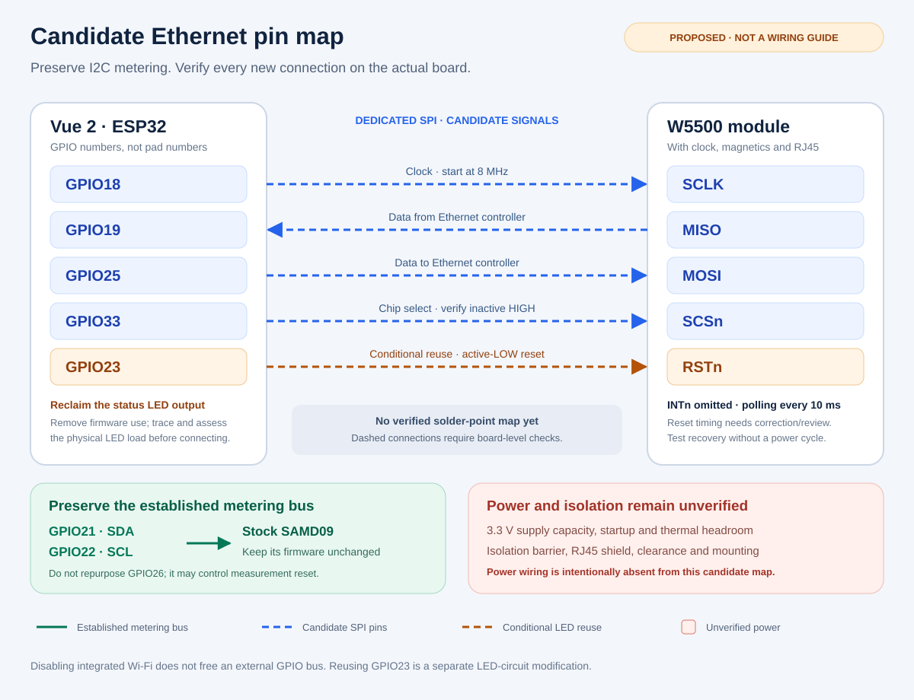
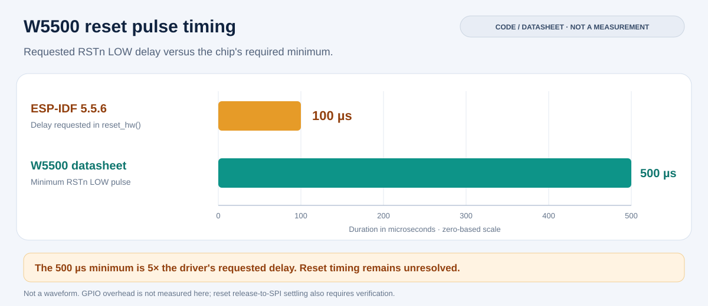

# Hardware design

This project explores adding a physical Ethernet port to an Emporia Vue 2 running ESPHome. The proposed interface is a W5500 connected to the existing ESP32 over SPI. The measurement controller continues to use its stock firmware and I2C connection.

**The physical modification is unverified.** The pin assignments below are design candidates, not a tested wiring guide. Do not build from the GPIO numbers alone: verify the actual board revision, existing connections, power supply, and electrical isolation first.

## Architecture

The intended signal path is:

```text
Stock measurement controller -- I2C --> ESP32 / ESPHome
                                         |
                                         SPI
                                         |
                                       W5500 -- Ethernet magnetics -- RJ45
```

Use a W5500 module with a documented schematic, its required clock and support components, and Ethernet magnetics. A connector alone cannot provide Ethernet. A module with integrated RJ45 and magnetics avoids designing the analog Ethernet interface from scratch; it does not establish the safety of the complete modified device. See the [WIZnet hardware resources](https://docs.wiznet.io/Product/Chip/Ethernet/W5500).

The initial firmware uses Ethernet only, a dedicated SPI connection at 8 MHz, and a 10 ms polling interval. Polling avoids an interrupt wire and requires a compatible ESP-IDF version; ESPHome documents support from ESP-IDF 5.1.4. These are starting settings, not a measured throughput or latency guarantee: polling is not the measurement sampling interval, and the SPI rate is not the Ethernet payload rate. Do not share the dedicated Ethernet SPI host with another configured peripheral. See the [ESPHome Ethernet component](https://esphome.io/components/ethernet/).

## Candidate pin allocation

These are **ESP32 GPIO numbers**, not module pad numbers, connector positions, or confirmed solder points.



| Function | Candidate GPIO | Required board check |
| --- | --- | --- |
| W5500 SCLK | 18 | Confirm that no existing circuit drives or depends on it. |
| W5500 MISO | 19 | Confirm that no existing circuit drives or depends on it. |
| W5500 MOSI | 25 | Confirm that no existing circuit drives or depends on it. |
| W5500 SCSn | 33 | Trace existing pull resistors and confirm a valid inactive-high level during startup. |
| W5500 RSTn | 23 | Verify and disconnect or otherwise account for the existing status LED circuit. |
| W5500 INTn | Not connected | Use polling in the firmware. |

The [partial reverse-engineered schematic](https://github.com/emporia-vue-local/emporia-vue2-reversing/blob/21f51a2572f2c8cb512ff7646d784a1f75fca82f/vue2_schematic.pdf) shows open-ended GPIO18/19/25 connections and a pull-up on GPIO33. However, its [author describes it as a partial reconstruction from photographs](https://community.openenergymonitor.org/t/emporia-vue-2-alternate-firmware/18939/9). Missing connections on that drawing are not proof that pins are unused. No verified PCB test-point map is provided here.

Do not substitute pins from an arbitrary ESP32 development-board example. For an ESP32-WROVER-B/IB module, GPIO16/17 are not available as ordinary exposed module pins, and GPIO6–11 serve the module's flash. GPIO34–39 are input-only on the ESP32; GPIO0/2/5/12/15 have boot-strapping roles. The module part number also determines its memory configuration: do not infer flash size from the amount of PSRAM or from the compiler fixture. Identify the actual module and detected flash size before preparing firmware. See [Espressif's module pin and boot tables](https://documentation.espressif.com/esp32-wrover-b_datasheet_en.html).

### Preserve the measurement interface

Keep GPIO21 as I2C SDA and GPIO22 as I2C SCL. GPIO13/14 are associated with measurement-controller debugging. GPIO12/27 serve the buzzer. Exclude GPIO26: an [existing firmware implementation assigns it to measurement-controller reset](https://github.com/rosenrot00/emporiavue/blob/e34af3280ad36fe876cf12e28e60399ebbaf8952/components/emporiavue/__init__.py#L1575). Ethernet does not require replacing that controller's firmware.

The [local firmware reference](https://github.com/emporia-vue-local/esphome/blob/dev/README.old.md) documents the normal I2C and indicator assignments. The proposed W5500 connection avoids the fixed RMII signals, which would conflict with GPIO21/22; see [Espressif's RMII pin allocation](https://docs.espressif.com/projects/esp-dev-kits/en/latest/esp32/esp32-ethernet-kit/user_guide.html).

### Disabling Wi-Fi does not free a GPIO bus

Wi-Fi is integrated into the ESP32. It is not an external radio connected through a reusable SPI bus. Disabling it does not release a set of external GPIOs, and the antenna connection is not a GPIO. See the [ESP32 architecture](https://www.espressif.com/en/products/socs/esp32/documentation).

GPIO23 is a separate status LED output. It can be considered for reuse because the indicator is optional, not because it carries Wi-Fi traffic. Remove every firmware LED/output/automation assignment on GPIO23 before assigning it to Ethernet reset. The physical LED load remains after a YAML change: trace its polarity, series components, and behavior while the ESP32 output is high impedance. A verified LED branch can be disconnected to remove that load; this project does not identify an unverified resistor for removal.

RSTn is preferable to a fast SPI signal for this reclaimed output. Nevertheless, it must reach valid logic levels throughout startup and reset. Factory firmware or another configuration that drives GPIO23 as an indicator is incompatible with using that same connection as W5500 reset. Before restoring factory firmware, disconnect this added reset connection and restore the original LED circuit as needed; restoring a flash backup alone does not restore the original hardware.

## Reset and startup

The [W5500 datasheet](https://docs.wiznet.io/assets/files/W5500_ds_v110e-226ffec190c588b69f88d629789585e1.pdf), section 5.5.1, requires RSTn low for at least 500 microseconds and specifies up to 1 ms for PLL lock after reset release. Budget at least that settling interval after a valid release before the first SPI access, then verify the actual waveform. The 1 ms value is a maximum device settling time to accommodate, not a maximum permitted firmware delay.

The preferred five-signal design gives ESPHome control of RSTn so it can reset the Ethernet controller when the ESP32 restarts without a power cycle. This requires a compliant reset implementation: the [ESP-IDF 5.5.6 W5500 driver](https://github.com/espressif/esp-idf/blob/880a203ae603d08a94d06aa01e0d6761958e5e9e/components/esp_eth/src/spi/w5500/esp_eth_phy_w5500.c#L152-L164) requests only a 100-microsecond low pulse and has no explicit delay after release. That requested pulse is shorter than the datasheet minimum. This is a source-level compliance gap, not a measurement of the actual pulse or proof that every module fails. A direct GPIO connection with that unmodified reset sequence is not an approved design here.



Chart sources: [ESP-IDF 5.5.6 reset implementation](https://github.com/espressif/esp-idf/blob/880a203ae603d08a94d06aa01e0d6761958e5e9e/components/esp_eth/src/spi/w5500/esp_eth_phy_w5500.c#L152-L164) and [W5500 datasheet, reset timing](https://docs.wiznet.io/assets/files/W5500_ds_v110e-226ffec190c588b69f88d629789585e1.pdf). The bars compare code and specification; GPIO overhead and the resulting physical pulse have not been measured. Recheck the actual linked driver when changing ESPHome, ESP-IDF, or a component override; this result is not a claim about every driver version.

Resolve reset assertion and startup timing together before hardware acceptance. Correcting the driver to hold reset low for at least 500 microseconds and wait for the specified settling interval is one option; any hardware pulse extension also needs coordinated firmware timing. The [Ethernet initialization sequence](https://github.com/espressif/esp-idf/blob/880a203ae603d08a94d06aa01e0d6761958e5e9e/components/esp_eth/src/esp_eth.c#L243-L251) enters MAC initialization after hardware reset, and the [W5500 MAC implementation](https://github.com/espressif/esp-idf/blob/880a203ae603d08a94d06aa01e0d6761958e5e9e/components/esp_eth/src/spi/w5500/esp_eth_mac_w5500.c#L276-L319) starts SPI reset operations before its device-ID retry loop. A supervisor that merely extends reset can therefore leave the chip held in reset during those SPI operations. Measure the final sequence rather than relying on retry behavior. A separate early boot pulse does not fix a later noncompliant driver pulse.

Ensure SCSn is inactive during startup. Account for the module's existing reset circuitry and all pull resistors; opposing pull-up and pull-down resistors can create an invalid logic level. Do not connect competing push-pull reset drivers together.

A four-signal variant is possible with polling and a separate power-on-reset/supply-supervisor circuit. Its limitation is recovery: a supply supervisor does not detect an ESP32 software restart while the Ethernet supply remains stable. SPI reinitialization may recover normal operation, but cannot guarantee recovery from a controller that no longer responds to SPI. An independent reset path or power cycle is then needed. Connecting to ESP32 EN also does not detect every software restart. A simple RC delay is not a verified supervisor: slow supply ramps, short outages and incomplete capacitor discharge can change the pulse. A supervisor's reset-release delay must also finish before the firmware accesses the chip.

## Power and isolation

W5500 draws about 132 mA during 100 Mb/s transmission under the datasheet's typical conditions, approximately 0.44 W at 3.3 V before regulator losses. These are typical values, not a power-supply design maximum. Confirm the complete module's requirements, startup demand, regulator headroom, and temperature. Disabling Wi-Fi does not prove that the existing supply can support the new load. See [WIZnet electrical characteristics](https://docs.wiznet.io/Product/ioModule/W5500-io).

Check the chosen module's input pin requirements rather than assuming a pin labelled `VCC` means the same thing on every board. The W5500 chip operates from 3.3 V; some carrier boards accept a different input through a regulator. Its advertised 5 V input tolerance does not make the ESP32 or the whole assembly 5 V tolerant. Verify MISO voltage, reset/CS pull-up rails and any level shifters against both devices' specifications. Do not feed 5 V into an assumed 3.3 V rail.

Define how the assembly behaves with either side unpowered. SPI, reset or pull-up paths can energize an unpowered device through its signal pins; a bench supply can also back-feed an onboard regulator. Select the bench injection point, return path and any power isolation deliberately. Do not parallel a UART adapter's supply with another source or assume its 3.3 V output can power the complete assembly. Power sequencing and current limiting are part of the design, not a wiring detail to discover after applying power.

The available reverse-engineering material does not establish that the accessible logic supply and ground constitute a safe isolated interface. A visible power transformer alone is insufficient evidence: voltage-sensing paths and all connections to the new port must also be assessed. Standard Ethernet magnetics alone do not prove adequate mains isolation for the modified assembly.

Before connecting a new external port in line-powered operation, establish the required isolation barrier, creepage and clearance, component ratings, shield connections, and enclosure protection. If a shared logic ground cannot be justified, the design needs an appropriate SPI isolation barrier and a separately isolated Ethernet-side supply, with no ground or shield path bypassing the barrier.

Initial logic and network tests must use a board disconnected from mains and an appropriate low-voltage bench supply. This includes disconnecting the measurement/voltage leads, not merely disabling a software feature. Do not connect a USB/UART adapter, ordinary logic analyzer, or grounded oscilloscope to a mains-connected Vue. Line-powered validation belongs in a suitably equipped electrical lab. The [firmware preparation guidance](https://emporia-vue-local.github.io/docs/tutorial/intro/) also prohibits flashing while connected to mains. Without mains voltage references, bench tests establish digital behavior only; they cannot establish metering accuracy.

## Mechanical integration

Use short, secured SPI connections or an adapter PCB. A permanent assembly must not depend on loose flying leads. Locate the Ethernet board and connector so they do not reduce required clearances or expose conductors. Provide strain relief and mechanical support so inserting an Ethernet cable cannot flex solder joints or the original PCB.

Document the RJ45 shield connection explicitly; do not assume it should connect to logic ground or the enclosure. Recheck insulation around mounting screws, connector cutouts, and any accessible metal. This design does not add PoE support and does not claim certification of a modified assembly.

Continue with the [verification plan](verification.md) before treating any candidate allocation as usable hardware.
